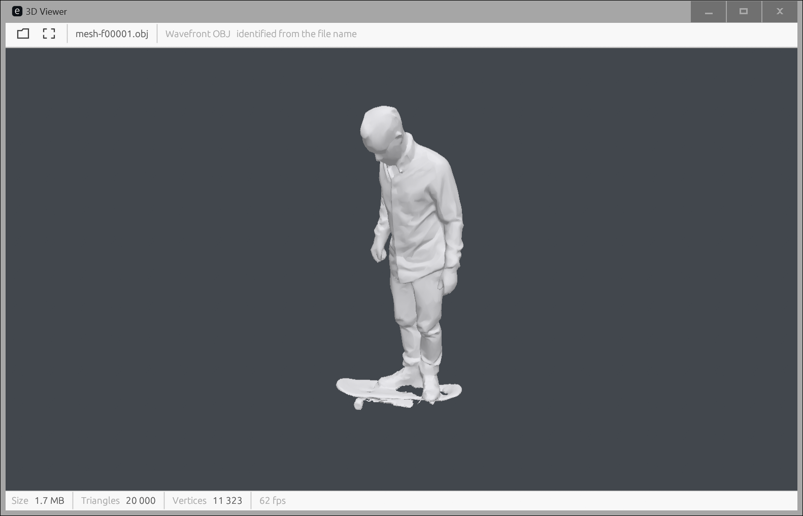
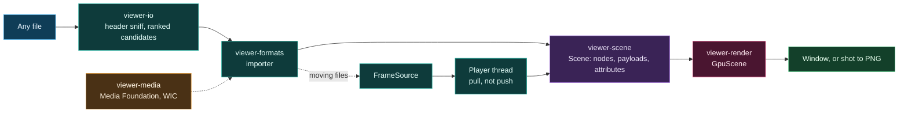
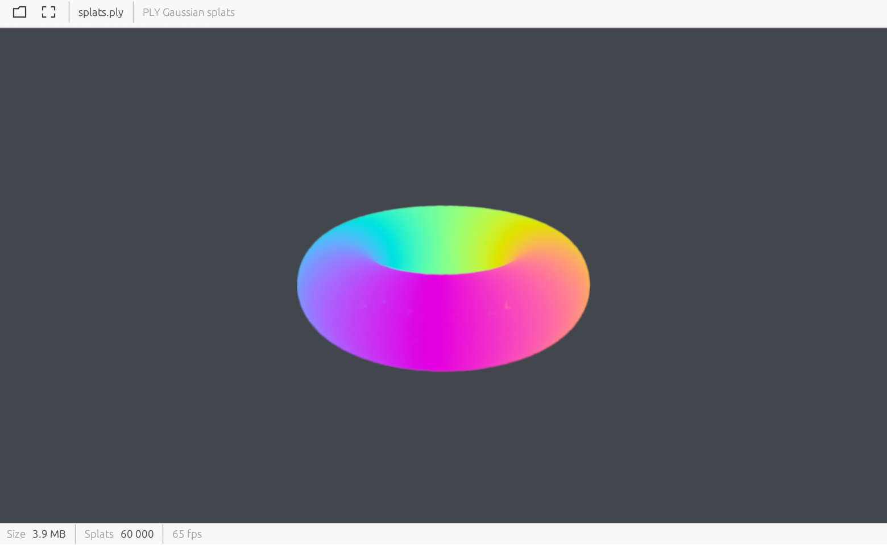

<p align="center"></p>

<h1 align="center">theViewer</h1>

<p align="center"><strong>by <a href="https://gantasmo.com">GANTASMO</a></strong></p>

<p align="center">
  <a href="https://www.rust-lang.org/"></a>
  <a href="https://wgpu.rs/"></a>
  
  
  <br>
  
  
  
  
</p>

---

Microsoft deprecated Windows 3D Viewer in February 2026, removed it from Windows in June, and
pulled it from the Microsoft Store in July. No shipped desktop 3D viewer currently exists on the
platform.

**theViewer** is the replacement. Native Rust and wgpu. One 16.5 MB executable that imports 20
Windows system DLLs and nothing else: no webview, no runtime, no redistributables. Double-click a
file and it opens, whether that file is a printer STL, a 132-slice MR series, a 60,000-splat
capture, a phone panorama, or nine seconds of volumetric video.

The app identifies files from their header bytes rather than their extension, so a `.ply` that is
really 3D Gaussian splats renders as splats and an `.mp4` sitting beside a Depthkit sidecar opens
as a moving surface. Every format reduces to one of five payload types and six renderer paths,
which is what keeps a survey of around 230 extensions from turning into 230 special cases.

<p align="center">
  
</p>

## Quickstart

**Double-click `Open theViewer.vbs`. That is the entire setup.** It builds when the sources have
changed, then opens the window. Build output goes to `tools\build.log`.

`target\release\viewer.exe` also runs directly, with or without a file path. On first launch it
offers to add itself to the Windows **Open with** menu. That registration is per-user, changes no
existing default, and is reversible from the toolbar menu or with `viewer open-with remove`.

Dropping a file on the window opens it, and so does `Ctrl+O`.

## Formats

The full survey of around 230 extensions is in [docs/FORMATS.md](docs/FORMATS.md), including the
formats that cannot simply be supported and why. What works today:

### Geometry, splats and volumes

| Format | Extension | Verified against |
|---|---|---|
| glTF 2.0 and 2.1, binary and JSON | `.glb` `.gltf` | corpus |
| Wavefront OBJ | `.obj` | corpus, ARES bake output |
| PLY: mesh, point cloud, 3DGS, SuperSplat compressed | `.ply` | corpus |
| STL, binary and ASCII | `.stl` | corpus |
| FBX | `.fbx` | a Unity asset |
| 3MF | `.3mf` | a 13,814-triangle print model, millimetres converted correctly |
| STEP | `.step` `.stp` | a 2-shell CAD part, 95,401 triangles after tessellation |
| OpenUSD | `.usd` `.usda` `.usdc` `.usdz` | synthetic stages: composition, units, up-axis, transforms |
| SPZ v1 to v4 | `.spz` | synthetic |
| antimatter15 splat | `.splat` | synthetic |
| PCD | `.pcd` | synthetic: ascii, binary, binary_compressed |
| LAS and LAZ | `.las` `.laz` | synthetic |
| E57 | `.e57` | synthetic |
| Geomview OFF, and the `C`, `N`, `4` and `ST` variants | `.off` | corpus, an 800-vertex quad torus |
| ASCII point clouds | `.xyz` `.pts` `.asc` | corpus, both the colour and the Leica layouts |
| DICOM series | `.dcm` | a 132-slice MR series |
| NIfTI | `.nii` `.nii.gz` | synthetic |
| NRRD | `.nrrd` | synthetic |
| MetaImage, split and inline, plain and zlib | `.mhd` `.mha` | corpus, a 64-cubed shell |

OBJ and FBX load their materials and textures from the same folder automatically. Opening one
DICOM slice stacks the whole series into a volume, ordered by `ImagePositionPatient` projected on
the slice normal rather than by `InstanceNumber`.

### Pictures

`.png` `.jpg` `.gif` `.bmp` `.webp` `.tif` `.tga` `.qoi` `.ico` `.dds` `.ppm` `.hdr` `.exr`

EXIF orientation is honoured, so photographs are the right way up. Radiance and OpenEXR are tone
mapped rather than clipped. Animated GIF, animated WebP and APNG play. HEIF, AVIF and anything
else the platform has a codec for go through Windows Imaging Component, which is how a `.heic`
opens without this build carrying an HEVC decoder.

### 360 and stereo

Equirectangular photographs and video are wrapped around the viewer rather than shown flat.
Detection reads, in order: XMP `GPano` metadata, the MP4 spherical boxes (V1 `uuid` XML and V2
`st3d` and `sv3d`), the file name, and finally the 2:1 aspect ratio. The last is an explicit guess
and the toolbar puts it one click from being corrected.

Over-under and side-by-side stereo pairs show one eye, switchable from the toolbar, with the
aspect corrected for the packing.

### Video and volumetric video

| Format | Notes |
|---|---|
| `.mp4` `.mov` `.mkv` `.webm` `.avi` `.wmv` | Decoded by Windows Media Foundation |
| `.ares` | ARES volumetric video: animated geometry plus a video texture track |
| `.mp4` with a Depthkit sidecar | RGBD capture, unprojected to a moving surface |
| `.4ds` | 4DViews HOLOSYS: the container is read and reported, the blocks need a licensed codec |

**What plays depends on the machine.** This app ships no codecs. It asks Windows, and Windows
answers for whatever is installed. H.264 and HEVC are always present. VP9 and AV1 arrive as
Microsoft Store extensions and often are not. When a codec is missing the viewer names it and says
which Store extension supplies it.

## Controls

The same gestures mean the same things everywhere. What they do follows the content.

| Input | Model or capture | Photograph | Panorama |
|---|---|---|---|
| Left drag | Orbit | Pan | Look around |
| Right or middle drag | Pan | | |
| Wheel | Zoom, or step slices on a volume | Zoom | Field of view |
| Double click | | Fit against 1:1 | |
| `F` | Fit | Fit | Recentre |

Anything that plays gets the same three controls, overlaid on the picture and fading out when the
pointer leaves: play, a scrub line, one timecode.

| Key | Action |
|---|---|
| `Space` | Play or pause |
| `Left` and `Right` | Step one frame |
| `Home` and `End` | Start, end |
| `L` | Loop |
| `Ctrl+O` | Open |
| Drop a file | Open |

Volumes get a side panel: slice against raymarch, plane axis and position, maximum intensity
projection, threshold, opacity, and window and level in the source units the scanner recorded.

## Command line

```
viewer identify <path>...            format identification from header bytes only
viewer identify --dir <folder>       identify every file in a folder
viewer info <path>...                identify, import, decode a few frames, report
viewer shot <in> <out.png>           render one frame to a PNG, with no window
                                     [--size WxH] [--time SECONDS]
viewer open-with add|remove|status   manage the Windows Open with entry
```

`identify` reads header bytes and decodes nothing, which makes it safe to run against confidential
captures. `shot` needs no display at all, which is what makes the renderer checkable on a build
agent. Both reporting commands need a build with the console attached:

```powershell
cargo build --release -p viewer-app --features console
```

Full reference with real output and exit codes: [docs/CLI.md](docs/CLI.md).

## Architecture

Files enter through the sniffer, become a `Scene`, and leave through one of six renderer paths.
Anything that moves also returns a `FrameSource`, which the player pulls on its own thread.



**The keystone is the scene model.** It is glTF 2.1 semantics plus `KHR_gaussian_splatting`
attribute semantics rather than a neutral model of this project's own design. Every importer
becomes a thin translation into a vocabulary the industry already agreed on, export is nearly
free, and splat attributes round-trip losslessly.

**Attributes stay in the precision they arrived in.** A `u16`-quantized position array travels from
file to GPU buffer without widening to `f32` on the CPU, and the vertex shader dequantizes against
the bounding box. SPZ's int24 fixed point has its own component type for the same reason.

**Five payloads, six paths.**

| Payload | Renderer path | Feeds from |
|---|---|---|
| `TriMesh` | Mesh raster | Parity set, CAD tessellation, volcap frames |
| `PointCloud` | Point sprite | PLY, PCD, LAS, LAZ, E57 |
| `SplatCloud` | Sorted splat | PLY 3DGS, SPZ, `.splat` |
| `VolumeGrid` | Volume raymarch | DICOM, NIfTI, NRRD |
| `Screen` (flat) | Flat picture | Photographs, video, animated pictures |
| `Screen` (equirect) | Panorama | 360 photographs and video |

<p align="center">
  
</p>

Every decision and its reason is in [docs/ARCHITECTURE.md](docs/ARCHITECTURE.md).

## Layout

```
crates/scene/     Scene model. glTF 2.1 and KHR_gaussian_splatting semantics. No dependencies.
crates/io/        Magic-byte sniffing, memory-mapped reads.
crates/formats/   Importers, sidecar and texture resolution, meshopt, ARES, Depthkit, STEP, USD.
crates/media/     Windows Media Foundation and WIC. Ships no codecs.
crates/render/    wgpu. mesh.wgsl, splat.wgsl, volume.wgsl, screen.wgsl and their Rust sides.
crates/app/       Window, viewport, controls, playback, shell integration, command line.
plugins/          T1 formats, resolved lazily. Empty today.
tools/            The build-and-launch script and the corpus generator.
```

23,311 lines of Rust and 539 of WGSL across six crates. `viewer-scene` has no dependencies at all,
which is deliberate: everything imports into it, so it is the piece that must never churn.

| Crate | Rust | Tests |
|---|---|---|
| `viewer-scene` | 1,476 | 25 |
| `viewer-io` | 1,666 | 46 |
| `viewer-media` | 1,560 | 17 |
| `viewer-formats` | 12,989 | 231 |
| `viewer-render` | 2,649 | 32 |
| `viewer-app` | 2,777 | 36 |

## Build

The build targets `x86_64-pc-windows-gnu`, pinned in `rust-toolchain.toml`. Visual Studio on the
development machine has the MSVC compiler but no Windows 10 or 11 SDK, so the `msvc` target cannot
link. The `gnu` target needs `dlltool` from MinGW binutils, which rustup does not ship.

```powershell
winget install Rustlang.Rustup
winget install BrechtSanders.WinLibs.POSIX.MSVCRT --scope user
rustup toolchain install stable-x86_64-pc-windows-gnu
```

The launcher locates MinGW under `%LOCALAPPDATA%\Microsoft\WinGet\Packages` on its own. MinGW is
needed to *build*. The resulting executable needs nothing but Windows, which is what lets Explorer
launch it, and keeping it that way takes real care in the link line. See
[docs/BUILDING.md](docs/BUILDING.md).

```powershell
cargo build --release -p viewer-app
cargo test --workspace
cargo clippy --workspace --all-targets
```

## Test corpus

```powershell
node tools\make-corpus.mjs
```

Writes `corpus\`: a PLY cube, an OBJ sphere, a binary STL cube, a two-node GLB, a textured OBJ, a
60,000-splat 3DGS PLY torus, and two equirectangular test patterns. One carries GPano metadata and
one carries nothing, so both the declared and the guessed panorama paths have a fixture. The
corpus is deterministic, needs no npm install, and is not tracked.

## Documentation

| Document | Contents |
|---|---|
| [docs/USER_GUIDE.md](docs/USER_GUIDE.md) | The manual. Every control, view mode, and what the app does with each kind of file. |
| [docs/API.md](docs/API.md) | Every public item in the six crates, with signatures and the reason each exists. |
| [docs/CLI.md](docs/CLI.md) | `identify`, `info`, `shot`, `open-with`, with real output and exit codes. |
| [docs/FORMATS.md](docs/FORMATS.md) | The survey of around 230 extensions, the tiering rules, and the reality checks. |
| [docs/ARCHITECTURE.md](docs/ARCHITECTURE.md) | The decisions and their reasons. |
| [docs/BUILDING.md](docs/BUILDING.md) | Toolchain, the windows-gnu constraint, self-containment, the corpus. |
| [docs/TROUBLESHOOTING.md](docs/TROUBLESHOOTING.md) | Symptoms, causes, fixes, and the traps that cost real time. |
| [HANDOFF.md](HANDOFF.md) | Current state, next steps, and everything not yet done. |

## Status

State as of 2026-08-26.

| Check | Result |
|---|---|
| `cargo fmt --all -- --check` | Clean |
| `cargo clippy --workspace --all-targets -- -D warnings` | Clean. Two transitive dependencies carry a future-incompatibility notice. |
| `cargo test --workspace` | 362 passing, 0 failing |
| `cargo doc --workspace --no-deps` | Clean with `RUSTDOCFLAGS=-D warnings` |
| Release binary | 17,298,432 bytes |
| `objdump -p` imports | 20 DLLs, every one a Windows system DLL |

All four gates run on every push through [.github/workflows/ci.yml](.github/workflows/ci.yml).

Not implemented, deliberately and knowingly: audio, `.sog`, Matroska spherical metadata, MV-HEVC
spatial video, JPEG 2000, spherical harmonic evaluation above degree 0, a compute-shader splat
sort, and materials or instancing in USD. [HANDOFF.md](HANDOFF.md) carries the full list with the
reasoning, along with 24 traps worth remembering.

## Built with

- **[wgpu](https://wgpu.rs)** is the graphics layer, targeting DX12 and Vulkan from one codebase.
- **[egui and eframe](https://github.com/emilk/egui)** carry the window and the interface.
- **[Khronos](https://www.khronos.org)** define glTF 2.1 and `KHR_gaussian_splatting`, which are
  this project's internal vocabulary rather than merely an import target.
- **[ufbx](https://github.com/ufbx/ufbx)**, **[image](https://github.com/image-rs/image)**,
  **[gltf](https://github.com/gltf-rs/gltf)**, **[dicom-rs](https://github.com/Enet4/dicom-rs)**,
  **[nifti-rs](https://github.com/Enet4/nifti-rs)**, **[las-rs](https://github.com/gadomski/las-rs)**,
  **[e57](https://github.com/cry-inc/e57)**, **[truck](https://github.com/ricosjp/truck)** and
  **[openusd-rs](https://github.com/Traverse-Research/openusd-rs)** parse the formats this project
  does not parse itself.
- **[meshoptimizer](https://github.com/zeux/meshoptimizer)** by Arseny Kapoulkine is the source of
  the vertex codec ported in `crates/formats/src/meshopt.rs`, credited in that file.
- **Windows Media Foundation** and **Windows Imaging Component** decode every moving picture and
  every platform-only still. This project ships no codecs.

Volume viewer conventions come from the author's own WebGL2 medical viewer, credited in
`crates/render/src/volume.wgsl`. The `.ares` container reader follows the author's own reference
implementation, and the Depthkit decode gates come from that project's rebuild-pipeline notes; both
are credited in the files that use them.

## License

MIT or Apache-2.0, at the recipient's option. See [LICENSE-MIT](LICENSE-MIT) and
[LICENSE-APACHE](LICENSE-APACHE).

---

<p align="center"><sub>Made by <a href="https://github.com/danieljtrujillo">Daniel Joaquin Trujillo</a>.</sub></p>
