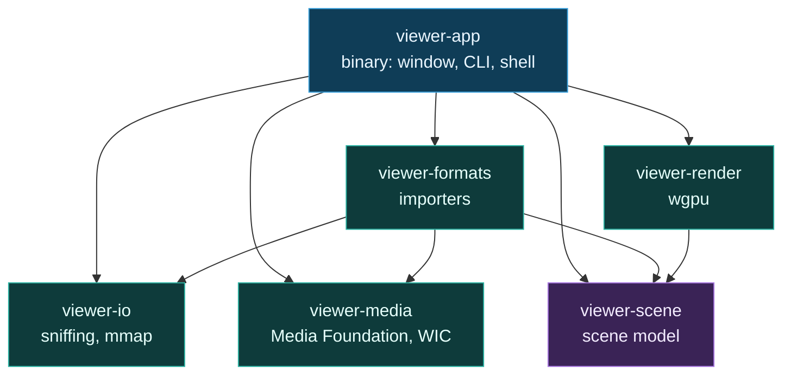

# API Reference

Every public item in the six workspace crates, with the signature and the reason it exists.
Companion to [ARCHITECTURE.md](ARCHITECTURE.md), which explains the design, and
[FORMATS.md](FORMATS.md), which is the format survey the design has to satisfy.

None of these crates are published to crates.io. They are workspace members, referenced by path.

## Crate graph



`viewer-scene` has no dependencies at all. Every other crate imports into it, so it is the piece
that must never churn or drag a version conflict into the tree.

| Crate | Lines | Tests | Dependencies |
|---|---|---|---|
| `viewer-scene` | 1,470 | 25 | none |
| `viewer-io` | 1,435 | 36 | `memmap2` |
| `viewer-media` | 1,559 | 17 | `windows` (Windows only) |
| `viewer-formats` | 11,557 | 199 | 20 external crates, listed in `crates/formats/Cargo.toml` |
| `viewer-render` | 2,632 Rust, 539 WGSL | 32 | `wgpu`, `glam`, `bytemuck` |
| `viewer-app` | 2,701 | 14 | `eframe`, `rfd`, `wgpu`, `pollster`, `image`, `windows` |

---

## viewer-scene

The model every format imports into. The shape is glTF 2.1 semantics plus
`KHR_gaussian_splatting` attribute semantics, so an importer is a translation into a vocabulary
the industry already agreed on rather than into one invented here.

### Scene

```rust
pub struct Scene {
    pub nodes: Vec<Node>,
    pub roots: Vec<NodeId>,
    pub cameras: Vec<CameraRig>,
    pub timeline: Option<Timeline>,
    pub meta: Metadata,
    pub materials: Vec<Material>,
    pub images: Vec<Image>,
    pub dynamic_images: Vec<u32>,
    pub dynamic_meshes: Vec<NodeId>,
}
```

`dynamic_images` and `dynamic_meshes` name the slots a player rewrites as playback advances. The
renderer allocates those as writable textures and growable buffers rather than upload-once ones,
which is what keeps a video from rebuilding a bind group sixty times a second.

| Method | Signature | Notes |
|---|---|---|
| `new` | `fn new() -> Scene` | Same as `Default::default()`. |
| `push` | `fn push(&mut self, node: Node) -> NodeId` | Adds a node without making it a root. |
| `push_root` | `fn push_root(&mut self, node: Node) -> NodeId` | The common case for a flat import. |
| `get` | `fn get(&self, id: NodeId) -> Option<&Node>` | |
| `push_material` | `fn push_material(&mut self, material: Material) -> u32` | Returns the table index. |
| `push_image` | `fn push_image(&mut self, image: Image) -> u32` | Returns the table index. |
| `material` | `fn material(&self, index: Option<u32>) -> Option<&Material>` | Accepts the `Option` a `TriMesh` carries. |
| `push_dynamic_image` | `fn push_dynamic_image(&mut self, image: Image) -> u32` | Registers a player-owned slot. Initial contents are the poster frame. |
| `is_dynamic_image` | `fn is_dynamic_image(&self, index: u32) -> bool` | |
| `screen` | `fn screen(&self) -> Option<&Screen>` | How the app decides between orbit mode and picture mode. |
| `set_meta` | `fn set_meta(&mut self, key: impl Into<String>, value: impl Into<String>)` | Overwrites an existing key instead of duplicating it. |
| `bounds` | `fn bounds(&self) -> Aabb` | Union of every payload's local bounds. Node transforms are not applied. |
| `is_empty` | `fn is_empty(&self) -> bool` | True when no node carries a payload. |
| `summary` | `fn summary(&self) -> Summary` | Counts, for the status bar and for `viewer info`. |

### Summary

```rust
pub struct Summary {
    pub meshes: usize,      pub triangles: usize,   pub vertices: usize,
    pub point_clouds: usize, pub points: usize,
    pub splat_clouds: usize, pub splats: usize,
    pub volumes: usize,      pub voxels: usize,
    pub screens: usize,      pub pixels: usize,
}
```

### Node and NodeId

```rust
pub struct NodeId(pub u32);

pub struct Node {
    pub name: String,
    pub transform: Mat4,
    pub children: Vec<NodeId>,
    pub payload: Option<Payload>,
}
```

`payload` is `None` for grouping nodes, which is glTF's own model. Keeping it optional preserves
hierarchy for the formats that carry meaningful structure (USD, IFC, 3D Tiles) instead of
flattening it away.

Constructors: `Node::group(name)` and `Node::with_payload(name, payload)`. Both start at
`IDENTITY`.

### Aabb

```rust
pub struct Aabb { pub min: [f32; 3], pub max: [f32; 3] }
pub const Aabb::EMPTY: Aabb;   // min = +inf, max = -inf
```

The box starts inverted so that `expand` on the first point produces a correct result rather than
a box anchored at the origin. It doubles as the dequantization range for quantized attributes,
which is why it lives at the crate root rather than inside a geometry type.

| Method | Signature |
|---|---|
| `expand` | `fn expand(&mut self, p: [f32; 3])` |
| `is_empty` | `fn is_empty(&self) -> bool` |
| `extent` | `fn extent(&self) -> [f32; 3]` |
| `center` | `fn center(&self) -> [f32; 3]` |
| `radius` | `fn radius(&self) -> f32` |
| `union` | `fn union(&self, other: &Aabb) -> Aabb` |

`union` ignores empty operands in both directions, so folding over a mixed list is safe.

### Mat4, IDENTITY, Metadata

```rust
pub type Mat4 = [f32; 16];        // column-major, matching glTF
pub const IDENTITY: Mat4;
pub type Metadata = Vec<(String, String)>;
```

`Metadata` is deliberately untyped. Every format carries provenance worth showing (title, capture
rig, colour space, codec, orientation) and modelling all of it would be endless, while throwing it
away makes the details panel useless.

### Timeline

```rust
pub struct Timeline {
    pub frame_count: u32,
    pub fps: f32,
    pub duration_us: u64,
    pub seekable: bool,
}

fn frame_at(&self, t_seconds: f64) -> u32   // clamped to 0 ..= frame_count - 1
```

The frame store is not here on purpose. `.ares` GOPs, per-frame folders and video keyframe tables
all resolve lazily through [`FrameSource`](#framesource), so a timeline describes the shape of
playback and lets the player pull frames on demand instead of holding thousands resident.

### attr::Attribute

The piece that makes the memory posture work. An attribute keeps bytes exactly as the source file
stored them, plus enough type information for the renderer to hand them to the GPU unchanged.

```rust
pub struct Attribute {
    pub semantic: Semantic,
    pub component: ComponentType,
    pub components: u8,        // 1 SCALAR, 2 VEC2, 3 VEC3, 4 VEC4
    pub count: usize,          // elements, not bytes and not components
    pub normalized: bool,
    pub quant_range: Option<Aabb>,
    pub data: Vec<u8>,
}

fn new(semantic, component, components, count, data) -> Result<Attribute, AttrError>
fn normalized(self) -> Attribute
fn quantized_to(self, range: Aabb) -> Attribute
fn stride(&self) -> usize
fn byte_len(&self) -> usize
fn get_f32(&self, i: usize, out: &mut [f32]) -> bool
```

`new` checks that `data.len()` equals `count * components * component.size()` before anything
allocates. That is the cheapest possible corruption gate and every importer runs it.

`get_f32` is the slow path, for code that genuinely needs CPU-side values: bounds computation on a
format that did not record its own AABB, and the details panel. The render path never calls it. It
uploads `data` and dequantizes in the shader. Out-of-range indices return `false` rather than
panicking.

```rust
pub enum ComponentType { I8, U8, I16, U16, I24, U32, F32 }
const fn size(self) -> usize        // 1, 1, 2, 2, 3, 4, 4
const fn is_integer(self) -> bool
```

`I24` has no glTF equivalent. It exists because SPZ stores positions as little-endian signed
24-bit fixed point, and unpacking it early would defeat the point of the module.

```rust
pub enum Semantic {
    Position, Normal, Tangent,
    TexCoord(u8), Color(u8), Joints(u8), Weights(u8),
    SplatRotation,                       // KHR_gaussian_splatting:ROTATION, VEC4 quaternion
    SplatScale,                          // KHR_gaussian_splatting:SCALE, VEC3
    SplatOpacity,                        // KHR_gaussian_splatting:OPACITY, SCALAR
    SplatSh { degree: u8, index: u8 },   // SH_DEGREE_{d}_COEF_{i}, VEC3
    Custom(String),
}

fn gltf_name(&self) -> Option<String>
```

`gltf_name` returns `None` where no standardized spelling exists, which is the honest answer for
`Custom` and for spherical harmonic degree 4. SPZ 4 raised the ceiling to degree 4; the Khronos
extension stops at 3, so a degree-4 import has no lossless glTF export. That is a real gap in the
ecosystem, recorded here rather than papered over.

```rust
pub enum AttrError {
    LengthMismatch { expected: usize, actual: usize },
    ZeroComponents,
}
```

### payload::Payload

Five things a node can contain, feeding six renderer paths. Keeping the enum small is what keeps
the renderer at six paths instead of one per format.

```rust
pub enum Payload { TriMesh, PointCloud, SplatCloud, VolumeGrid, Screen }

fn bounds(&self) -> Aabb
fn render_path(&self) -> RenderPath
```

```rust
pub enum RenderPath {
    MeshRaster, PointSprite, SortedSplat, VolumeRaymarch,
    FlatImage, Panorama,
    VideoTexturedSequence, UnprojectedRgbd,
}
```

The last two are properties of a sequence rather than of a single payload, so `render_path` never
returns them.

#### TriMesh

```rust
pub struct TriMesh {
    pub attributes: Vec<Attribute>,
    pub indices: Indices,
    pub bounds: Aabb,
    pub material: Option<u32>,
}

fn attribute(&self, semantic: &Semantic) -> Option<&Attribute>
fn vertex_count(&self) -> usize
fn triangle_count(&self) -> usize
fn needs_derived_normals(&self) -> bool
```

```rust
pub enum Indices { None, U16(Vec<u16>), U32(Vec<u32>) }
fn len(&self) -> usize
fn is_empty(&self) -> bool
```

Index width stays as narrow as the source allows. A 16-bit index buffer is half the upload of a
32-bit one, and many formats never exceed 65,535 vertices per primitive.

`needs_derived_normals` matters early: STL has no usable topology at all, and `.4ds` frames arrive
with per-vertex UVs but no normals.

#### PointCloud

```rust
pub struct PointCloud {
    pub attributes: Vec<Attribute>,
    pub count: usize,
    pub bounds: Aabb,
}

fn attribute(&self, semantic: &Semantic) -> Option<&Attribute>
```

#### SplatCloud

```rust
pub struct SplatCloud {
    pub attributes: Vec<Attribute>,
    pub count: usize,
    pub bounds: Aabb,
    pub sh_degree: u8,          // 0 ..= 4
    pub antialiased: bool,      // SPZ flags bit 0; changes covariance dilation
    pub orbit_hint: Option<Aabb>,
}

fn attribute(&self, semantic: &Semantic) -> Option<&Attribute>
const fn sh_coef_count(degree: u8) -> usize   // 0, 3, 8, 15, 24
fn needs_gpu_sort(&self) -> bool              // count > 100_000
```

`orbit_hint` is modelled and not yet wired up. No importer sets it and the renderer does not read
it. It exists because SPZ 4's Adobe vendor extension `0xADBE0002` carries safe orbit bounds, and
framing those rather than the raw AABB is what gives a splat capture a sane default camera. Until
an importer populates it, every splat file is framed on its raw bounds.

The sort threshold is deliberately low. Measured captures run 1.9 M splats for one room and SPZ 4
targets 34 M and above, so the CPU path exists for test fixtures rather than for real content.

#### VolumeGrid

```rust
pub struct VolumeGrid {
    pub dims: [u32; 3],
    pub spacing: [f32; 3],      // world size of one voxel
    pub voxel: VoxelType,
    pub bounds: Aabb,
    pub data: Vec<u8>,
    pub window: Option<(f32, f32)>,
}

fn voxel_count(&self) -> usize
fn expected_bytes(&self) -> usize
fn is_consistent(&self) -> bool

pub enum VoxelType { U8, U16, I16, F32 }
const fn size(self) -> usize
```

`spacing` is not optional in practice. DICOM and NIfTI both carry real physical spacing, and
ignoring it renders anatomy at the wrong aspect ratio.

Sparse grids (VDB, NanoVDB) do not fit this shape and will need a sibling type.

#### Screen

The payload that does not become geometry.

```rust
pub struct Screen {
    pub image: u32,             // index into Scene::images
    pub projection: ScreenProjection,
    pub stereo: StereoLayout,
    pub width: u32,             // source pixels, before any stereo split
    pub height: u32,
}

fn flat(image: u32, width: u32, height: u32) -> Screen
fn aspect(&self) -> f32
fn bounds(&self) -> Aabb
fn is_panorama(&self) -> bool
```

```rust
pub enum ScreenProjection {
    Flat,
    Equirect { horizontal_fov: f32 },   // 360 for a panorama, 180 for VR180
}
```

Storing the arc rather than a `Full` or `Half` flag keeps GPano's `CroppedArea` fields, which
describe partial panoramas, representable.

```rust
pub enum StereoLayout { Mono, OverUnder, SideBySide }

fn left_eye_uv(self) -> ([f32; 2], [f32; 2])          // texture scale and offset
fn unpacked_aspect(self, width: u32, height: u32) -> f32
```

`unpacked_aspect` undoes the packing, so a 2:1 over-under VR180 frame is treated as the 1:1 half
sphere it actually is.

#### MeshFrame

```rust
pub struct MeshFrame {
    pub positions: Vec<[f32; 3]>,
    pub normals: Vec<[f32; 3]>,
    pub uvs: Vec<[f32; 2]>,
    pub indices: Vec<u32>,
    pub bounds: Aabb,
}

fn vertex_count(&self) -> usize
fn is_keyframe(&self) -> bool     // !indices.is_empty()
```

An empty `indices` means unchanged. In an inter-coded stream the topology is set by the keyframe
and every predicted frame after it moves the same vertices, so re-uploading an index buffer that
did not change is the most expensive mistake available on this path.

### material::Material and material::Image

```rust
pub struct Image {
    pub name: String,
    pub width: u32,
    pub height: u32,
    pub rgba: Vec<u8>,          // exactly width * height * 4
}

fn is_consistent(&self) -> bool
fn white() -> Image             // 1x1, substituted for a texture that failed to load
```

Images decode to RGBA8 here because every renderer path wants one upload format, and the source
encodings (PNG, JPEG, TGA, embedded FBX blobs, DICOM frames) have nothing in common beyond what
they decode to.

```rust
pub struct Material {
    pub name: String,
    pub base_color: [f32; 4],
    pub base_color_texture: Option<u32>,
    pub metallic: f32,
    pub roughness: f32,
    pub emissive: [f32; 3],
    pub alpha_mode: AlphaMode,
    pub alpha_cutoff: f32,
    pub double_sided: bool,     // true by default
}

fn named(name: impl Into<String>) -> Material
fn roughness_from_shininess(ns: f32) -> f32

pub enum AlphaMode { Opaque, Mask, Blend }
```

Backface culling is off by default because scans and per-frame reconstructions carry inconsistent
winding, and culling them hides half the surface.

`roughness_from_shininess` converts the Blinn-Phong exponent that OBJ's `Ns` and FBX's shininess
both use. The mapping is the usual inverse square root and is approximate by nature, since the two
shading models do not correspond exactly.

### camera::CameraRig

The recorded rig that produced a capture, not the viewport camera. COLMAP sparse models and
`transforms.json` both carry one.

```rust
pub struct CameraRig {
    pub name: String,
    pub transform: Mat4,               // camera-to-world, column-major
    pub projection: Projection,
    pub resolution: Option<(u32, u32)>,
    pub image: Option<String>,
}

fn perspective(name: impl Into<String>, transform: Mat4) -> CameraRig
fn yfov_from_focal(focal_px: f32, height_px: f32) -> f32

pub enum Projection {
    Perspective { yfov: f32, aspect: Option<f32>, znear: f32, zfar: Option<f32> },
    Orthographic { xmag: f32, ymag: f32, znear: f32, zfar: f32 },
}
```

---

## viewer-io

Format identification and the shared streaming layer.

### Source

```rust
pub struct Source { /* private */ }

fn open(path: impl AsRef<Path>) -> io::Result<Source>
fn path(&self) -> &Path
fn len(&self) -> u64
fn is_empty(&self) -> bool
fn bytes(&self) -> &[u8]
fn header(&self) -> &[u8]                                  // up to HEADER_BYTES
fn range(&self, offset: u64, len: u64) -> Option<&[u8]>
fn identify(&self) -> Vec<Candidate>
```

The file is memory-mapped, not read. A 200 M-point LiDAR tile or an 8.5 GB splat capture has to be
addressable without being resident, and importers slice this rather than copying it.

`range` is bounds-checked and returns `None` rather than panicking, because every offset passed to
it ultimately comes from a length field inside an untrusted file.

The `unsafe` block behind `Source::open` is the only one in the workspace. `memmap2::Mmap::map` is
unsafe because another process can mutate or truncate the file while it is mapped. A read-only
viewer accepts that: the failure mode is garbage bytes, which every parser here already validates
against. Every other crate carries `#![forbid(unsafe_code)]` or `#![deny(unsafe_code)]`.

### sniff

```rust
pub const HEADER_BYTES: usize = 8192;

pub fn sniff(header: &[u8], file_len: u64, name: Option<&str>) -> Vec<Candidate>
pub fn ply_variant(header: &[u8]) -> PlyVariant
```

`sniff` returns candidates sorted by descending confidence. An empty result is impossible: an
unrecognized file yields a single `FormatId::Unknown`. The file name is a tie-breaker and never a
verdict on its own.

8,192 bytes is sized for the longest header that still matters. A 3DGS PLY declares roughly 62
properties before `end_header`, and NIfTI's magic sits at offset 344.

```rust
pub struct Candidate {
    pub format: FormatId,
    pub confidence: Confidence,
    pub note: &'static str,     // why this candidate was produced, shown in the details panel
}

pub enum Confidence { ExtensionOnly, Heuristic, Structural, Magic }
```

`Confidence` derives `Ord` in that order, so a weak structural guess can never outrank a real
magic-byte match.

```rust
pub enum FormatId {
    Glb { sixty_four_bit: bool }, GltfJson, Obj, Ply(PlyVariant),
    StlBinary, StlAscii, ThreeMf, Fbx,
    Spz(SpzEncoding), Splat, Sog,
    Step,
    Image(ImageKind), Video(VideoKind),
    Ares, Depthkit, FourDs,
    Pcd, Las, E57, Nrrd, Nifti, Dicom,
    Usda, Usdc, Usdz, Zip, Gzip, Isobmff,
    Unknown,
}

fn is_supported(&self) -> bool
fn label(&self) -> &'static str
```

`Sog`, `Zip`, `Gzip`, `Isobmff` and `Unknown` are recognized without being importable. Naming a
format the app cannot open is a better failure than a spinner that never resolves.

```rust
pub enum PlyVariant { Mesh, PointCloud, GaussianSplat, CompressedGaussianSplat }
pub enum SpzEncoding { Gzip, PlaintextV4 }

pub enum ImageKind {
    Png, Jpeg, Gif, Bmp, Tiff, WebP, Tga, Qoi, Ico, Dds, Pnm, Farbfeld, Hdr, OpenExr,
    Avif, Heif, Jpeg2000, Svg,
}
fn is_decodable(self) -> bool     // false for Svg only
fn label(self) -> &'static str

pub enum VideoKind { Mp4, QuickTime, Matroska, WebM, Avi, Asf, MpegTs, MpegPs, Flv, Ogg }
fn label(self) -> &'static str
```

AVIF, HEIF and JPEG 2000 have no Rust decoder in this build, so they route to the platform through
[`viewer_media::decode_image`](#still-images). SVG is different in kind: it is vector, and there
are no pixels to sample at any size.

### Ambiguities the sniffer resolves

| Ambiguity | Resolution |
|---|---|
| `.ply` is four formats | Parse the ASCII header. `f_dc_*` plus `scale_*` plus `rot_*` means 3DGS, an element named `chunk` means SuperSplat-compressed, faces mean mesh, none of the above means point cloud. |
| `.spz` is two encodings | Plaintext `NGSP` at offset 0 means v4 or newer. Gzip magic `1f 8b` means v1 to v3, whose `NGSP` sits inside the compressed stream. v4 has to be tested first. |
| `.mp4` is five things | Plain video, Depthkit CPP, Microsoft HoloVideo, V3C/V-PCC, or MV-HEVC spatial. Needs box-level inspection plus sidecar detection. |
| `.splat` has no header | 32 bytes per splat and no magic. `len % 32 == 0` plus value-range plausibility, at `Heuristic` confidence only. |
| `.glb` has two widths | The version field distinguishes standard from the glTF 2.1 64-bit variant. |
| `.nii.gz` against `.gz` | Two-part extensions are matched first: `.copc.laz`, `.nii.gz`, `.ome.tif`, `.ept.json`. |

---

## viewer-formats

The T0 importers, statically linked, no lazy resolution. Each importer turns bytes into a
`Scene` while keeping data in source precision.

### Entry points

```rust
pub fn open(format: &FormatId, bytes: &[u8], path: Option<&Path>) -> Result<Opened, ImportError>
pub fn import(format: &FormatId, bytes: &[u8], path: Option<&Path>) -> Result<Scene, ImportError>
pub fn open_path(format: &FormatId, bytes: &[u8], path: &Path) -> Result<Opened, ImportError>
pub fn import_path(format: &FormatId, bytes: &[u8], path: &Path) -> Result<Scene, ImportError>
```

`path` is the file's own location, and formats that reference companion files need it: OBJ's
`mtllib` and its textures, FBX's texture references, DICOM's sibling slices, Depthkit's metadata
sidecar. Passing `None` disables all of that rather than failing, which is what an in-memory
import wants.

`import` discards any playback and is what the command line and the tests use.

### Opened, Frame, FrameSource

```rust
pub struct Opened {
    pub scene: Scene,
    pub frames: Option<Box<dyn FrameSource>>,
}

fn still(scene: Scene) -> Opened
```

Two return values rather than one because a static scene and a playing one are genuinely different
things. Video, volumetric video and animated pictures all describe their shape once (a screen, a
mesh, a material) and then stream their contents.

```rust
pub trait FrameSource: Send {
    fn timeline(&self) -> Timeline;
    fn frame_at(&mut self, pts_us: u64) -> Result<Option<Frame>, ImportError>;
}
```

Pull, not push. The player owns the clock and asks for the frame it needs, which is what makes
scrubbing, pausing and stepping work identically for a GIF, an MP4 and an `.ares` capture.
`Ok(None)` means the frame already on screen is still correct, which is the answer to roughly half
of all calls at 60 Hz display and 30 fps content.

`Send` because the player runs the source on its own thread. A hardware video decode that takes
12 ms must not be 12 ms of a dropped UI frame.

```rust
pub struct Frame {
    pub index: u32,
    pub pts_us: u64,
    pub image: Option<Image>,     // replaces the scene's first dynamic image
    pub mesh: Option<MeshFrame>,
}
```

Both fields are optional because most sources drive only one: a video replaces the texture, a mesh
sequence replaces the geometry, `.ares` does both.

### ImportError

```rust
pub enum ImportError {
    Unimplemented(FormatId),
    NeedsPath(FormatId),
    Malformed { format: FormatId, reason: String },
    Io(std::io::Error),
}
```

`Malformed` is the right answer whenever a length field disagrees with the file, an attribute
buffer is truncated, or a count would overflow. Allocating on a number that came out of an
untrusted file is the failure this variant exists to prevent.

### Importer modules

| Module | Entry point | Covers |
|---|---|---|
| `ply` | `import(bytes, PlyVariant) -> Scene` | Mesh, point cloud, 3DGS, SuperSplat compressed. |
| `obj` | `import(bytes, base) -> Scene` | Wavefront OBJ. Resolves `mtllib` through `mtl`. |
| `mtl` | `parse(text, base, &mut Scene) -> HashMap<String, u32>` | MTL library to material indices. |
| `stl` | `import_binary(bytes)`, `import_ascii(bytes)` | Both STL spellings. |
| `gltf_import` | `import(bytes, binary: bool) -> Scene` | GLB when `binary`, glTF JSON otherwise. |
| `fbx` | `import(bytes, base) -> Scene` | FBX through `ufbx`, with sibling textures. |
| `threemf` | `import(bytes) -> Scene` | 3MF, including the millimetre to metre conversion. |
| `step` | `import(bytes) -> Scene` | ISO 10303 Part 21, tessellated through `truck`. |
| `usd` | `import(path) -> Scene` | `.usda`, `.usdc`, `.usdz`. Needs a path: a stage composes layers. |
| `spz` | `import(bytes, SpzEncoding) -> Scene` | SPZ v1 to v4. |
| `splat` | `import(bytes) -> Scene`, `STRIDE = 32` | The antimatter15 `.splat` layout. |
| `pcd` | `import(bytes)`, `parse_header(bytes)`, `decompress(body)` | ascii, binary, binary_compressed. |
| `lidar` | `import_las(path)`, `import_e57(path)`, `MAX_POINTS = 20_000_000` | LAS, LAZ, E57. |
| `volume` | `import_nrrd(bytes)`, `import_nifti(path)`, `import_dicom(path)` | NRRD, NIfTI, DICOM series. |
| `picture` | `import(bytes, ImageKind, path) -> Opened` | 13 raster encodings plus animated GIF, WebP, APNG. |
| `movie` | `import(path, bytes, VideoKind) -> Opened`, `format_duration(us)` | Container video through Media Foundation. |
| `ares` | `import(path, bytes) -> Opened`, `parse_header(bytes) -> Header` | ARES volumetric video. |
| `depthkit` | `import(path, Intrinsics) -> Opened`, `detect(video)`, `unproject(...)` | RGBD capture, unprojected per frame. |
| `fourds` | `probe(bytes, file_len) -> Option<Structure>`, `unsupported(...)` | 4DViews container reporting. |
| `spherical` | `detect(xmp, file_name, width, height) -> Spherical` | Panorama and stereo detection. |
| `isobmff` | `spherical(bytes) -> Option<Spherical>` | MP4 spherical boxes, V1 `uuid` XML and V2 `st3d`/`sv3d`. |
| `sidecar` | `resolve_texture(base, reference)`, `load_image(path)`, `decode_image(bytes, name)` | Companion file resolution. |
| `meshopt` | `decode_vertex_buffer(dst, count, size, buf) -> Result<(), DecodeError>` | meshopt vertex codec, versions 0 and 1. |

### Types worth naming

```rust
// ares
pub struct Header { /* magic, version, track table, superblock index */ }
pub struct Superblock { /* byte range and frame range of one block */ }
pub struct Gop { /* seekable group of pictures */ }
pub enum TextureCodec { /* AV1, VP9, and the rest of the track's declared codecs */ }
pub enum TextureBlob { /* where a texture frame's bytes live inside its block */ }

// depthkit
pub struct Intrinsics {
    pub width: u32, pub height: u32,
    pub focal: (f32, f32), pub principal: (f32, f32),
    pub near: f32, pub far: f32,
}
pub enum Layout {
    Stacked { depth_on_top: bool },
    SideBySide { depth_on_left: bool },
}
pub fn unproject(rgba: &[u8], frame: (u32, u32), k: &Intrinsics, layout: Layout,
                 depth_first: bool) -> MeshFrame

// spherical
pub struct Spherical {
    pub projection: ScreenProjection,
    pub stereo: StereoLayout,
    pub evidence: Evidence,
}
pub enum Evidence { Metadata, Name, AspectRatio, None }
fn label(self) -> &'static str

// meshopt
pub enum DecodeError { BadHeader, UnsupportedVersion(u8), Truncated, ExtraBytes }

// pcd
pub enum Encoding { /* Ascii, Binary, BinaryCompressed */ }
pub struct Header { /* fields, sizes, types, counts, width, height, point count */ }

// fourds
pub struct Structure { /* frame count, codecs, block layout */ }
```

`Evidence` is why the 360 toggle in the toolbar exists. A panorama detected from a 2:1 aspect ratio
is an explicit guess, and the toolbar puts it one click from being corrected.

### Panorama detection order

`spherical::detect` takes the first answer it gets, in this order:

1. XMP `GPano` metadata in the file, through `from_xmp`.
2. MP4 spherical boxes, through `isobmff::spherical`.
3. The file name, through `from_name`.
4. A 2:1 aspect ratio, through `from_aspect`, recorded as `Evidence::AspectRatio`.

---

## viewer-media

Video and still decoding through whatever the platform already has. This crate ships no codecs and
never will.

On Windows it drives Media Foundation, which is hardware accelerated on every GPU made this decade
and answers for whatever the machine has installed. H.264 and HEVC are always present. AV1 and VP9
arrive as Microsoft Store extensions and often are not. The consequence, stated plainly: what
plays depends on the machine, and the error says so rather than pretending the file is broken.

### Video

```rust
pub struct Video { /* private */ }

fn open(path: &Path) -> Result<Video, MediaError>
fn info(&self) -> &VideoInfo
fn next_frame(&mut self) -> Result<Option<VideoFrame>, MediaError>
fn seek(&mut self, pts_us: u64) -> Result<(), MediaError>
```

`seek` moves to the keyframe at or before `pts_us`, so the caller may have to decode forward a
little to reach the frame it actually wants.

```rust
pub struct VideoInfo {
    pub width: u32, pub height: u32,
    pub fps: f32, pub duration_us: u64,
    pub codec: String,          // empty when the platform will not say
}
fn frame_count(&self) -> u32

pub struct VideoFrame {
    pub pts_us: u64,
    pub width: u32, pub height: u32,
    pub rgba: Vec<u8>,
}
```

### StreamDecoder

A decoder for a bare stream of coded frames with no container around them. `.ares` needs this: its
texture track is AV1 or VP9 frames stored in the container's own chunks, so there is nothing to
demux and the decoder has to be fed directly.

```rust
pub struct StreamDecoder { /* private */ }

fn new(codec: Codec, width: u32, height: u32) -> Result<StreamDecoder, MediaError>
fn name(&self) -> String
fn decode(&mut self, data: &[u8], key: bool, pts_us: u64)
    -> Result<Option<VideoFrame>, MediaError>
fn flush(&mut self)

pub enum Codec { Av1, Vp9, H264, Hevc }
fn label(self) -> &'static str
```

`decode` returning `Ok(None)` means the decoder is still buffering, which is normal for the first
frames of a stream and is not an error.

`flush` is required on any backward seek. An inter-coded stream cannot be entered part way
through, and feeding a decoder frames out of order without telling it produces smeared garbage
rather than an error.

### Still images

```rust
pub struct Picture {
    pub width: u32, pub height: u32,
    pub rgba: Vec<u8>,
    pub decoder: String,        // which platform decoder produced it
}

pub fn decode_image(path: &Path) -> Result<Picture, MediaError>
pub fn can_decode_image(path: &Path) -> bool
```

HEIF and AVIF are the reason this exists, since both need a video codec and Windows already hosts
one. It is also the escape hatch for camera RAW, JPEG XR, and whatever the platform learns to read
next.

### MediaError

```rust
pub enum MediaError {
    Unsupported,              // this build has no decoder for this platform at all
    NoDecoder(String),        // the platform has none installed for this codec
    NoVideoTrack,
    Platform(String),
}
```

`NoDecoder` is separate from a broken file because it is recoverable by installing the matching
Video Extension from the Microsoft Store, and the message says so.

---

## viewer-render

wgpu. Six paths, four of them implemented: mesh raster, point sprite, sorted splat, volume
raymarch, flat picture, panorama. Video-textured sequence and unprojected RGBD reach the screen
through the mesh path with a dynamic image and a dynamic mesh rather than through paths of their
own.

Shaders are separate WGSL files because bind group indices are per shader module:
`mesh.wgsl`, `splat.wgsl`, `volume.wgsl`, `screen.wgsl`.

### Renderer

```rust
pub const DEPTH_FORMAT: wgpu::TextureFormat = wgpu::TextureFormat::Depth32Float;

pub struct Renderer { /* private */ }

fn new(device: &wgpu::Device, target: wgpu::TextureFormat) -> Renderer
fn upload(&self, device: &wgpu::Device, queue: &wgpu::Queue, scene: &Scene) -> GpuScene
fn ensure_depth(&mut self, device: &wgpu::Device, width: u32, height: u32)
fn depth(&self) -> Option<&wgpu::TextureView>
fn update_image(&self, device, queue, scene: &mut GpuScene, image: &Image)
fn update_mesh(&self, device, queue, scene: &mut GpuScene, frame: &MeshFrame)
fn prepare(&self, queue: &wgpu::Queue, scene: &mut GpuScene, view: &View<'_>)
fn draw(&self, pass: &mut wgpu::RenderPass<'_>, scene: &GpuScene)
```

`ensure_depth` and `depth` are split so the caller can take an immutable borrow for the whole
render pass. `wgpu::TextureView` is not `Clone`, so returning one from a `&mut self` method would
hold a mutable borrow across the draw calls.

`update_image` has a fast path and a slow one. Same size is a straight texture write with no
allocation and no bind group churn, and it is by far the common case. A size change means a new
texture, and then every bind group that named the old one has to be rebuilt.

`update_mesh` grows buffers and never shrinks them, with headroom. A volumetric capture's vertex
count wanders frame to frame, and reallocating on every wobble would spend more time in the
allocator than in the decoder. Buffers a player rewrites are created with `COPY_DST` from the
start.

`prepare` writes uniforms and re-sorts the splats when the viewpoint has moved enough. The sort is
a CPU radix sort today, which is a stand-in for a compute shader sort.

### GpuScene

```rust
pub struct GpuScene {
    pub bounds: Aabb,
    pub splat_count: usize,
    pub has_volume: bool,
    pub volume_range: Option<(f32, f32)>,
    /* private: buffers, bind groups, draw list, dynamic slots, sort scratch */
}

fn is_empty(&self) -> bool
fn screen(&self) -> Option<&Screen>
fn set_projection(&mut self, projection: ScreenProjection)
fn set_stereo(&mut self, stereo: StereoLayout)
fn has_dynamic_image(&self) -> bool
```

`volume_range` carries the source intensity range so window and level can be reported in the
original units rather than in normalized ones.

`set_projection` is the toolbar's 360 button in both directions.

### View

```rust
pub struct View<'a> {
    pub camera: &'a Camera,
    pub viewport: (f32, f32),   // physical pixels
    pub point_size: f32,
    pub volume: &'a VolumeView,
    pub flat: &'a FlatView,
}
```

One struct rather than six parameters. The set grew with every render path, and a call site
passing five positional floats is where a viewport gets its width and height the wrong way round.

### Camera

```rust
pub struct Camera {
    pub target: Vec3,
    pub distance: f32,
    pub yaw: f32,               // radians, about the up axis
    pub pitch: f32,             // radians, clamped just inside the poles
    pub fov_y: f32,
    pub znear: f32,
    pub zfar: f32,
}

fn frame(&mut self, bounds: &Aabb)
fn eye(&self) -> Vec3
fn view(&self) -> Mat4
fn proj(&self, aspect: f32) -> Mat4
fn view_proj(&self, aspect: f32) -> Mat4
fn orbit(&mut self, dx: f32, dy: f32)
fn zoom(&mut self, delta: f32)
fn pan(&mut self, dx: f32, dy: f32)
fn focal(&self, viewport: (f32, f32)) -> (f32, f32)
```

`proj` uses the DirectX depth convention (0 to 1), because that is what wgpu clips to.

`zoom` is multiplicative so the step feels constant at every scale. `pan` scales by distance so the
grab point tracks the cursor.

`focal` returns the vertical focal length in pixels, which the splat projection needs to size its
screen-space footprint. It has to agree with the projection matrix exactly.

### FlatView and ScreenUniform

```rust
pub struct FlatView {
    pub zoom: f32,              // 1.0 means fitted, not one texel per pixel
    pub offset: [f32; 2],       // pan, in units of half the viewport
    pub right_eye: bool,
}

const MIN_ZOOM: f32 = 0.05;
const MAX_ZOOM: f32 = 64.0;

fn zoom_by(&mut self, factor: f32)
fn pan(&mut self, dx: f32, dy: f32)
fn reset(&mut self)

pub fn zoom_for_one_to_one(image: (u32, u32), viewport: (f32, f32)) -> f32
```

Zoom 1.0 is fit because fit is what opening a photograph should do. One to one is a keystroke
away. Below 1.0 the pan offset resets to zero, which is what stops a zoomed-out picture from
sitting in a corner.

```rust
pub struct ScreenUniform {
    pub rect: [f32; 4],
    pub eye: [f32; 4],
    pub right: [f32; 4],
    pub up: [f32; 4],
    pub forward: [f32; 4],
    pub params: [f32; 4],
}

fn new(screen: &Screen, view: &FlatView, camera: &Camera, viewport: (f32, f32)) -> ScreenUniform
```

Matches `ScreenUniform` in `screen.wgsl` field for field.

### Volume controls

```rust
pub struct VolumeView {
    pub window: f32,            // full width of the displayed range, normalized
    pub level: f32,             // centre of that range
    pub mode: VolumeMode,
    pub axis: Axis,
    pub slice: f32,             // 0 to 1
    pub projection: Projection,
    pub threshold: f32,         // samples below this contribute nothing
    pub opacity: f32,
}

pub enum VolumeMode { Slice, Raycast }
pub enum Axis { Axial, Coronal, Sagittal }
fn label(self) -> &'static str
pub enum Projection { Composite, MaximumIntensity }

pub fn to_half(grid: &VolumeGrid) -> (Vec<u8>, (f32, f32))
```

Defaults are window 1.0, level 0.5, `Slice` mode, `Axial`, slice 0.5, `Composite`, threshold 0.12,
opacity 0.06.

`to_half` converts a grid to normalized 16-bit float samples and returns the source range that
produced them. Half precision rather than 8-bit because CT is 12-bit and MR routinely wider, and
baking a window into 8 bits would make the window control useless. Half is filterable everywhere
WebGPU runs, which 32-bit float is not.

`MaximumIntensity` is the standard read for angiography and bone.

### fit_matrix

```rust
pub fn fit_matrix(bounds: &Aabb) -> Mat4
```

Converts a bounding box to a matrix that centres and unit-scales it.

---

## viewer-app

A binary crate, so nothing here is importable. Documented because the modules are where the
application's behaviour lives.

| Module | Contents |
|---|---|
| `main` | Argument dispatch. Subcommands go to `cli`; anything else opens the window. |
| `cli` | `identify`, `info`, `shot`, `open-with`, `usage`. See [CLI.md](CLI.md). |
| `ui` | Window, toolbar, viewport, details panel, playback bar, input handling. |
| `player` | The decode thread and the playback clock. |
| `shell` | Windows `Open with` registration. |
| `shot` | Offscreen render to PNG. |

### player::Player

```rust
pub struct Player {
    pub timeline: Timeline,
    pub clock_us: u64,          // presentation time, the single source of truth
    pub playing: bool,
    pub looping: bool,
    pub error: Option<String>,
    pub at_end: bool,
    /* private: channels, worker handle, inflight flag */
}

fn new(source: Box<dyn FrameSource>, timeline: Timeline) -> Player
fn duration_us(&self) -> u64
fn progress(&self) -> f32
fn toggle(&mut self)
fn seek_to(&mut self, pts_us: u64)
fn seek_fraction(&mut self, t: f32)
fn step(&mut self, frames: i32)
fn current_frame(&self) -> u32
fn advance(&mut self, dt: f32) -> Option<Frame>

pub fn timecode(us: u64) -> String
```

`advance` takes wall-clock seconds since the last call and clamps them. A stalled frame (a window
drag, a display sleep) would otherwise jump the clock forward by seconds and take a seek to
recover from.

`toggle` at the very end restarts rather than doing nothing, which is what every other player does
and what the gesture obviously means. `step` implies pausing, since nobody steps through a playing
video.

The decoder runs on its own thread and the coalescing loop drains requests carefully:
`while let Ok(Pattern) = rx.try_recv()` silently eats messages that do not match, which in an
earlier revision meant swallowing the stop message and hanging the join.

### shell

```rust
pub const PROG_ID: &str = "GANTASMO.3DViewer.1";
pub const APP_NAME: &str = "3D Viewer";
pub const EXTENSIONS: &[&str];      // every extension the viewer promises to open

pub enum Consent { Unasked, Deferred, Refused, Granted }

pub fn state_path() -> Option<PathBuf>
pub fn consent() -> Consent
pub fn record_consent(consent: Consent)
pub fn should_prompt() -> bool
pub fn is_registered() -> bool
pub fn register(exe: &Path) -> Result<(), String>
pub fn unregister() -> Result<(), String>
```

Registration is per-user, under `HKEY_CURRENT_USER`. It changes no existing default and is
reversible from the toolbar menu or with `viewer open-with remove`.

`EXTENSIONS` is kept explicit rather than derived from the sniffer's extension table. The list is a
promise to the operating system, and a format that is merely recognized should not appear in a menu
that implies it opens.

The consent flag is a file under `%LOCALAPPDATA%\3D Viewer\shell-prompt` rather than a registry
value, so clearing it to see the prompt again is something a person can do without regedit.

### shot

```rust
pub struct Options {
    pub width: u32,             // default 1280
    pub height: u32,            // default 720
    pub time_us: u64,           // default 0
}

pub fn render(input: &Path, output: &Path, options: &Options) -> Result<(), String>
```

Renders with no window and no surface. Row pitch for a buffer copy has to be a multiple of 256
bytes, so the readback buffer is usually wider than the image and every row is trimmed on the way
out.

This is the only way to check what the renderer produced on a machine whose desktop does not
composite a GPU window into a screen capture, which is the situation on any build agent and on the
development machine this project was written on.

---

## Worked example

Open a file, report what it holds, and render one frame.

```rust
use viewer_io::Source;

let source = Source::open("capture.ares")?;
let best = source.identify().remove(0);          // ranked, never empty
println!("{} ({:?})", best.format.label(), best.confidence);

let opened = viewer_formats::open_path(&best.format, source.bytes(), source.path())?;
let summary = opened.scene.summary();
println!("{} triangles, {} splats", summary.triangles, summary.splats);

if let Some(mut frames) = opened.frames {
    let timeline = frames.timeline();
    if let Some(frame) = frames.frame_at(timeline.duration_us / 2)? {
        println!("frame {} at {} us", frame.index, frame.pts_us);
    }
}
```

Upload and draw:

```rust
let renderer = viewer_render::Renderer::new(&device, target_format);
let mut gpu = renderer.upload(&device, &queue, &scene);

let mut camera = viewer_render::Camera::default();
camera.frame(&gpu.bounds);

let view = viewer_render::View {
    camera: &camera,
    viewport: (width as f32, height as f32),
    point_size: 3.0,
    volume: &volume_view,
    flat: &flat_view,
};
renderer.prepare(&queue, &mut gpu, &view);
renderer.draw(&mut pass, &gpu);
```

## Invariants worth keeping

1. Positions stay in source precision from file to GPU buffer. Nothing widens `u16` or `i24` to
   `f32` on the CPU so the vertex shader can narrow it again.
2. Every length field read from a file is validated before it is used to allocate.
3. `sniff` never returns an empty vector.
4. `Attribute::new` is the only way to build an attribute, so the length check cannot be skipped.
5. `target` is a reserved word in WGSL. Using it produces a silent shader compile failure whose
   only symptom is the window exiting with no message.
6. A wgpu pipeline and its render pass have to agree on the depth attachment. The picture paths
   write no depth and test none, and still declare a depth state.
